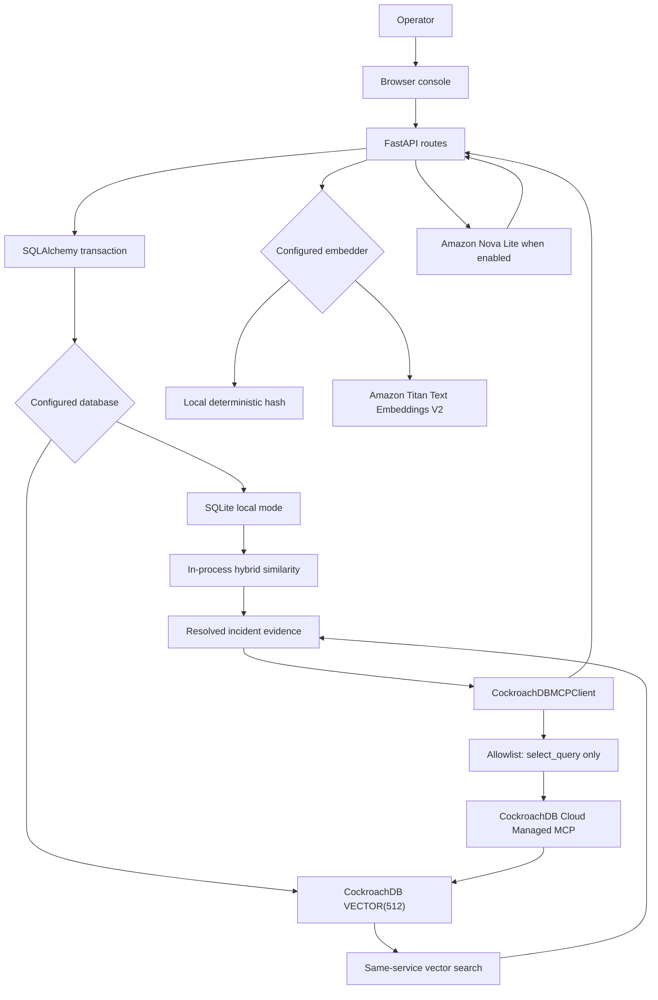
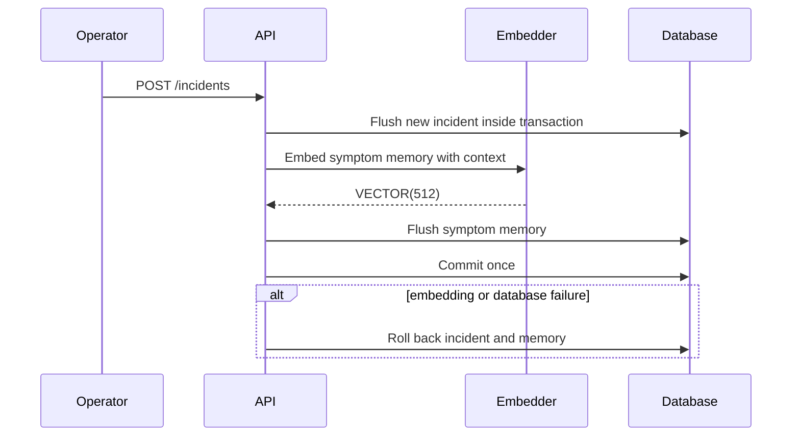

# RecallOps architecture

RecallOps separates operational state, durable memory, semantic retrieval, reasoning, and audit. The repository supports a credential-free local mode and contains production-oriented CockroachDB, Amazon Bedrock, and Managed MCP integration paths. No public AWS or CockroachDB Cloud deployment is claimed by this document.

## Component view



The Managed MCP client is a separate audit adapter that the investigation route automatically invokes for the top recalled recommendation when `USE_COCKROACH_MCP=true`. The browser console renders the returned audit receipt and the complete per-request tool execution trace.

## Data model

### `incidents`

This table holds current incident state:

- UUID-compatible string ID;
- title and normalized service name;
- symptoms and structured infrastructure context;
- current resolution, if any;
- `open` or `resolved` status;
- creation and update timestamps.

### `incident_memories`

This table is the application-level append-only evidence trail:

- memory ID and source incident ID;
- service scope;
- kind: `symptoms`, `resolution`, or `outcome`;
- original operator-provided content;
- JSON provenance metadata;
- 512-dimensional embedding;
- database-generated timestamp.

The application exposes no update or delete route for memory rows. Immutability is not enforced by a database policy, so the precise claim is append-only through the current API.

## Provenance

Every newly written memory records:

- embedding provider;
- embedding model or local fallback identifier;
- embedding dimensions;
- event-specific metadata, such as service or operator notes;
- memory ID, source incident ID, kind, content, and timestamp in recommendation evidence.

Infrastructure context is included in the text used to embed new memory events. Outcomes are operator-provided observations, not independently verified facts.

## Atomic write boundaries

### Create incident



The incident and symptom memory become visible together or neither is committed.

### Resolve incident

The API changes the incident to `resolved`, writes one resolution memory, writes one outcome memory, and commits once. If either embedding or any database operation fails, the status change and both new memories are rolled back.

This distinction matters: a proposed resolution and the operator-recorded outcome remain separate evidence items, but their state transition is atomic.

## Retrieval rules

The current incident's saved symptom embedding is reused as the query vector when available.

The CockroachDB query:

1. searches symptom memories only;
2. constrains the service prefix;
3. excludes the current incident;
4. joins the source incident and requires `status = 'resolved'`;
5. requires a non-null recorded resolution;
6. computes cosine relevance with `<=>`;
7. rejects scores below `MINIMUM_RELEVANCE` (`0.15` by default);
8. returns at most five nearest source incidents.

The distributed vector index is created as:

```sql
CREATE VECTOR INDEX incident_memory_embedding_idx
ON incident_memories (service, embedding vector_cosine_ops)
```

Bootstrap verifies that it is connected to CockroachDB when `REQUIRE_COCKROACHDB=true`, checks `feature.vector_index.enabled`, and creates the index if absent.

SQLite development mode applies the same service, resolved-status, resolution, threshold, and limit rules. Its score is a local blend of deterministic-vector cosine similarity and lexical overlap, so it is useful for workflow tests but is not numerically identical to the CockroachDB score.

Because the resolve route commits status, resolution memory, and outcome memory atomically, incidents resolved through the API provide outcome evidence to later investigations. The SQL predicate itself does not independently assert that an outcome row exists; externally modified or legacy data should be audited before being treated as complete.

## Recommendation evidence and Bedrock

For every recalled incident, the response includes:

- source incident ID, title, service, and status;
- rounded relevance score;
- recorded resolution and latest recorded outcome;
- overlapping terms for a small human-readable match explanation;
- all stored symptom, resolution, and outcome evidence with memory IDs, source IDs, metadata, and timestamps.

When relevant matches exist and `USE_BEDROCK=true`, this complete recommendation payload is passed to Amazon Nova Lite through the Bedrock Converse API. The prompt instructs Nova to explain which remembered resolution is safest to investigate first, to preserve uncertainty, and never to claim that an action was executed.

When Bedrock is disabled, RecallOps returns a deterministic local summary. When there are no qualifying memories, it returns a no-match message and does not call Nova.

Titan Text Embeddings V2 is invoked through Bedrock with 512 dimensions and normalization enabled when `USE_BEDROCK=true`. The default local embedder is deterministic and credential-free.

## CockroachDB Cloud Managed MCP audit

`app/mcp_client.py` implements the second CockroachDB tool as a deliberately narrow read-only audit path.

### Allowed operation

Only `select_query` is allowlisted. The client constructs the SQL itself; callers cannot provide SQL, table names, columns, ordering, or predicates. The query:

- accepts only a valid canonical incident UUID;
- selects ID, incident ID, service, kind, content, metadata, and timestamp;
- excludes the embedding column;
- orders deterministically;
- has a mandatory limit between 1 and 100;
- contains one `SELECT` and no statement separator.

### Protocol and credential safeguards

- endpoint must be HTTPS and cannot contain credentials, query parameters, or fragments;
- bearer authentication is attached through an HTTP client;
- `mcp-cluster-id` supports cluster scoping;
- redirects are disabled;
- configuration limits the timeout to 30 seconds;
- the server-advertised input schema is inspected, but unknown required arguments fail closed;
- non-allowlisted tool names are rejected before a session call;
- text and structured results are normalized while credential-shaped values are redacted;
- binary and embedded resource content is omitted from audit output.

The official MCP SDK is a pinned runtime dependency and is imported lazily. A real audit requires a CockroachDB Cloud cluster, a read-only service-account secret, and network access. Startup fails closed when MCP is enabled without both the API key and cluster ID.

The `/system` response reports whether MCP is configured, but that flag is not proof of a successful request. Each `/investigate` response records whether the bounded `select_query` completed, failed, or was skipped, and the browser renders that receipt. Live submission evidence must show a completed receipt for a recalled incident.

## Security boundaries

- RecallOps never executes a remediation.
- Incident read, write, resolution, and investigation routes use constant-time `X-API-Key` comparison when `API_KEY` is configured.
- Health, readiness, system-status, and the static operator console remain public so an AWS load balancer and judges can verify availability without exposing incident records.
- Input lengths and infrastructure payload size are bounded.
- Service names are normalized before storage and retrieval.
- Every HTTP response has a validated or generated request ID, and structured logs exclude bodies, query strings, and credentials.
- Database connections use pre-ping.
- Database passwords, AWS credentials, MCP secrets, and API keys must remain outside source control and images.
- Use a least-privilege AWS runtime role and a cluster-scoped read-only CockroachDB Cloud service account in a live deployment.

## Failure behavior

- Create and resolve operations explicitly roll back their complete transaction on embedding or database failure.
- Recognized boto3/Bedrock client failures return HTTP `502`; unexpected failures use the framework's normal error handling.
- `REQUIRE_COCKROACHDB=true` prevents startup against SQLite or a non-CockroachDB PostgreSQL-compatible server.
- `COMPETITION_MODE=true` prevents startup unless CockroachDB is required, Bedrock and MCP are enabled, and the application API key is configured.
- A required CockroachDB vector-index failure stops startup when CockroachDB is required.
- MCP schema mismatches, invalid IDs, unsafe limits, unavailable dependencies, and transport failures fail closed through typed client errors; an audit outage is surfaced as a failed tool receipt without exposing credentials or mutating data.
- No reasoning or audit failure can mutate infrastructure because neither path has an execution tool.

## Observability limits

- `/health` confirms that the API process can answer.
- `/ready` executes a database query and returns `503` when the database is unavailable.
- `/system` reports the detected database backend, selected providers, configured CockroachDB tool flags, vector-search mode, and relevance threshold.
- Provider labels describe configuration. The `/investigate` tool trace records the tools used for that request; live cloud logs and a captured successful request remain the deployment proof.

## Deployment boundary

The Dockerfile runs the API as a non-root user, and the Compose file provides a loopback-only local CockroachDB vector environment. `infra/aws` adds an undeployed ECS Fargate task definition, exact-model Bedrock IAM policy, secret-injection design, and deployment checklist. These templates are not evidence of an AWS deployment.

A competition deployment still needs a public HTTPS endpoint on AWS, CockroachDB Cloud with TLS, live Bedrock model access, live Managed MCP credentials, secret injection, runtime permissions, and recorded end-to-end verification.
